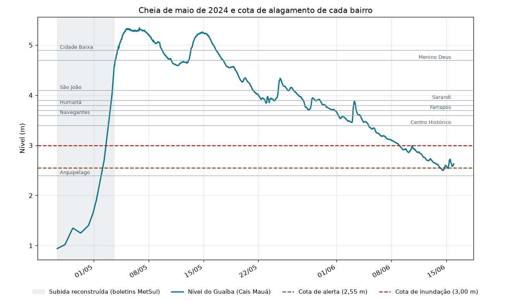

# AlertaCheia Python

Lógica de decisão do **AlertaCheia**: cruza o nível da água medido pelo sensor, os relatos dos moradores e a cota de cada bairro para decidir **quais bairros avisar, com quanta antecedência e o que cada morador deve fazer**.

Entrega da disciplina **Computational Thinking with Python** da Global Solution 2026.2 (FIAP).

## Integrantes

| Nome completo | RM |
| --- | --- |
| Arthur Veiga Demétrio | 570056 |

## Qual problema da cidade foi escolhido?

Alagamentos em Porto Alegre. Na cheia de maio de 2024, o Guaíba chegou a 5,37 m no Cais Mauá (medição revisada pelo Serviço Geológico do Brasil), muito acima da cota de inundação de 3,00 m, e muita gente só percebeu que a água estava subindo quando ela já estava na rua. Os boletins oficiais falam do nível do Guaíba em metros, mas o morador precisa saber outra coisa: **a minha rua vai alagar? quando? o que eu faço agora?**

## O que a solução proposta faz?

Transforma dados de nível da água em uma decisão por bairro.

1. **Coleta** as leituras do sensor de nível (projeto `alertacheia-edge`, publicadas no ThingSpeak) e as ocorrências que os moradores registram no app web (projeto `alertacheia-web`, gravadas no MockAPI). Guarda uma cópia de cada coleta em `dados/entrada`, para funcionar mesmo sem internet.
2. **Trata** os dados com pandas: descarta leituras inválidas, coloca a série em intervalos fixos, aplica média móvel e calcula a **taxa de subida em cm/h** (a derivada do nível no tempo).
3. **Decide** o estado de cada bairro pelas regras abaixo e diz o que fazer.
4. **Simula a cheia de 2024**: roda as mesmas regras hora a hora sobre a série real do Guaíba e mede quantas horas antes da água chegar cada bairro teria sido avisado.

### Resultado da simulação de 2024

Com as regras deste programa, o **primeiro aviso** (Atenção) teria saído de 16 a 24 horas antes da água chegar a cada bairro, e o **Alerta**, de 5 a 12 horas antes. Em 2024, muitos moradores só souberam quando a água já estava na rua.



As margens dos bairros são estimativas simuladas, então os horários por bairro ilustram o método; o nível do Guaíba é real.

Com isso, o programa responde à pergunta da atividade, "como os dados podem ajudar a compreender este problema e apoiar uma decisão?": a decisão é **quais bairros avisar agora**, e o dado que mostra o valor disso é **a antecedência do aviso**.

### Regras de decisão

Cada bairro começa a alagar em uma cota própria: a cota de inundação da régua mais uma margem do bairro (`dados/entrada/bairros.csv`). Com o nível atual e a taxa de subida, o programa prevê em quantas horas a água chega a essa cota.

| Estado | Quando | O que fazer |
| --- | --- | --- |
| Evacuar | a água já passou da cota do bairro | sair agora para lugar alto ou abrigo |
| Alerta | a água deve chegar em até 6 h | separar documentos e remédios e preparar a saída |
| Atenção | deve chegar em até 24 h, ou o nível passou do alerta do bairro | acompanhar os avisos e tirar objetos do chão |
| Normal | sem previsão de alagar | nada a fazer |

Os relatos dos moradores nas últimas 12 h podem **subir** o estado do bairro, nunca baixar: um relato de gravidade média leva a Atenção; um de gravidade alta, a Alerta; dois ou mais de gravidade alta, a Evacuar. Um relato sozinho pode estar errado, por isso só vários relatos graves levam a evacuar.

## Quickstart

Precisa de **Python 3.10 ou mais recente** (o menu usa `match-case`).

```bash
python -m pip install -r requirements.txt
python main.py
```

O menu:

```
1 - Atualizar dados (sensor e ocorrências)
2 - Ver a situação agora em cada bairro
3 - Simular a cheia de maio de 2024
4 - Consultar um bairro
0 - Sair
```

Também dá para rodar uma opção direto: `python main.py 3`.

Testes das regras de decisão e do cálculo da taxa:

```bash
python -m unittest
```

Para ver dados do sensor ao vivo, rode o simulador do projeto `alertacheia-edge` no Wokwi e use a opção 1.

## Dados

| Arquivo | O que é | Origem |
| --- | --- | --- |
| `dados/entrada/leituras_sensor.csv` | nível, estado e comporta medidos pelo sensor | coletado do canal do ThingSpeak pela opção 1 (dado simulado no Wokwi) |
| `dados/entrada/ocorrencias.json` | relatos de alagamento dos moradores | coletado do MockAPI do app web pela opção 1 (dado simulado) |
| `dados/entrada/bairros.csv` | margem de cada bairro em relação à cota de inundação | **estimativa simulada**, para demonstração |
| `dados/entrada/ana_87450020_2024.xls` | nível do Guaíba a cada 15 min, de 03/05 a 15/06/2024, como baixado | ANA, estação 87450020 (Usina do Gasômetro), site Hidro-Telemetria |
| `dados/entrada/guaiba_subida_2024.csv` | nível do Guaíba de 26/04 a 03/05/2024, na subida | boletins publicados pela MetSul |
| `dados/saida/situacao_bairros.csv` | estado e ação recomendada por bairro | gerado pela opção 2 |
| `dados/saida/guaiba_2024_cais_maua.csv` | série completa da cheia na régua do Cais Mauá, com a origem de cada valor | gerado pela opção 3 |
| `dados/saida/cheia_2024_antecedencia.csv` | antecedência do aviso por bairro em 2024 | gerado pela opção 3 |
| `dados/saida/cheia_2024.png` | gráfico do nível do Guaíba com a cota de cada bairro | gerado pela opção 3 |

Nenhum dado pessoal é usado. Os relatos e as margens dos bairros são simulados.

### Como a série da cheia de 2024 foi montada

Nenhuma fonte pública cobre a cheia inteira, então o programa junta duas (`alertacheia/guaiba.py`):

- **ANA, estação 87450020.** Medição real a cada 15 min, mas só a partir de 03/05/2024 às 15h, quando a estação começou a transmitir. O site entrega o nível na referência atual da estação; para voltar à régua do Cais Mauá usada nos boletins de 2024, o programa soma **120 cm**. O ajuste foi conferido em dois pontos publicados: o pico de 5,37 m aparece na série da ANA como 417 cm, e os 3,47 m de 02/06/2024 às 9h15 aparecem como 229 cm.
- **MetSul.** Valores da régua do Cais Central publicados dia a dia na subida, de 26/04 a 03/05/2024 de manhã. Entre um valor e outro, e até o primeiro dado da ANA, o nível é interpolado. Esses pontos são aproximados (alguns foram publicados como "acima de 4 m") e aparecem sombreados no gráfico.

Cotas usadas: alerta em 2,55 m e inundação em 3,00 m na régua do Cais Mauá, valores oficiais em 2024.

Fontes:
- [ANA, Sistema Hidro-Telemetria](https://www.snirh.gov.br/hidrotelemetria/)
- [MetSul: como está o Guaíba um ano depois do pico da grande enchente](https://metsul.com/como-esta-o-guaiba-um-ano-depois-do-pico-da-grande-enchente/)
- [Governo do RS: Estado atualiza cota de inundação do Guaíba na Usina do Gasômetro](https://www.estado.rs.gov.br/estado-atualiza-cota-de-inundacao-do-guaiba-na-usina-do-gasometro)
- [Jornal do Comércio: cheia do Guaíba atingiu a marca de 5,37 m no Cais Mauá](https://www.jornaldocomercio.com/geral/2024/09/1169858-cheia-do-guaiba-antigu-a-marca-537m-no-cais-maua-aponta-servico-geologico-brasileiro.html)
- [Agrolink: Guaíba a 3,47 m em 02/06/2024](https://www.agrolink.com.br/noticias/rs--guaiba-esta-abaixo-da-cota-de-inundacao_491728.html)

## Estrutura

```
main.py                 menu e fluxo do programa
alertacheia/
  config.py             caminhos, endereços das APIs, réguas e limites das regras
  coleta.py             download do sensor e das ocorrências, com cópia em arquivo
  tratamento.py         leitura, limpeza, média móvel e taxa de subida (pandas)
  decisao.py            regras de decisão por bairro
  guaiba.py             montagem da série do Guaíba (ANA + MetSul) na régua do Cais Mauá
  cheia2024.py          simulação da cheia de 2024 e gráfico
  relatorio.py          tabelas no terminal
dados/
  entrada/              dados usados
  saida/                dados gerados
tests/                  testes das regras
```

## Ficha da CitizenTech

| Campo | Resposta |
| --- | --- |
| Nome da CitizenTech | AlertaCheia |
| Cidade e bairro | Porto Alegre (RS), bairros às margens do Guaíba e de arroios que alagam com chuva forte |
| Cidadão beneficiado | Morador de área sujeita a alagamento, incluindo idosos e famílias sem acesso fácil a boletins oficiais |
| Problema, em uma frase | Moradores de áreas alagáveis descobrem tarde que a água está subindo na sua rua e perdem o tempo de proteger a família e os bens. |
| Como funciona | Um sensor mede o nível da água e age sozinho no local; este programa em Python cruza as leituras com os relatos dos moradores e a cota de cada bairro e decide quem avisar; o app web mostra o nível e reúne os relatos. |
| O que cada parte faz | **Sensor (Edge):** mede o nível, fecha a comporta e publica no ThingSpeak. **Lógica (este repositório):** decide o alerta por bairro. **Matemática:** modela a subida do nível, a taxa de variação e o volume acumulado. **Interface e Interação:** painel do sensor e registro de ocorrências. **Experiência:** jornada do morador e requisitos. **Pitch:** a história da solução. |
| Indicador de impacto | Horas de antecedência entre o primeiro aviso e a chegada da água em cada bairro. |
| ODS conectados | 11 (cidades sustentáveis: menos pessoas afetadas por desastres), 13 (adaptação a eventos climáticos extremos), 9 (infraestrutura e inovação com sensores de baixo custo e dados abertos) |

## Uso de IA

Ver [prompts.md](prompts.md).
